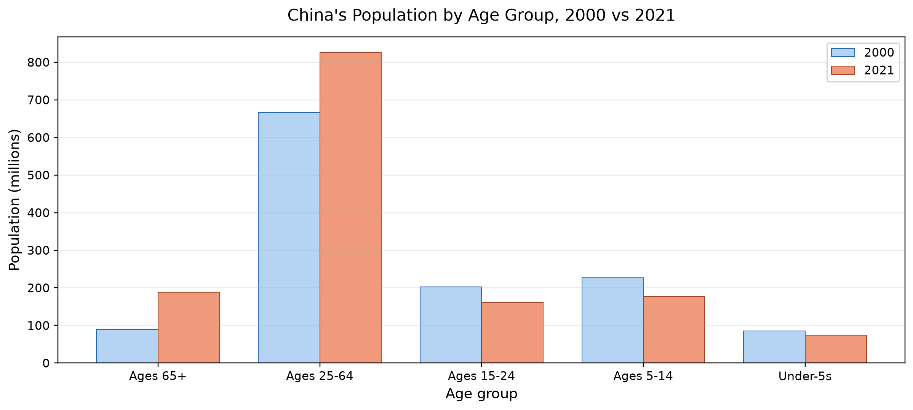

# The Chinese Stroke Paradox: More Deaths Despite Lower Risk

A small, fully reproducible analysis of stroke mortality in China between 2000 and 2021.

**Status:** Completed (course project, CISC7204, University of Macau, 2026)

---

## 1. The problem

Between 2000 and 2021, China's **age-standardised** stroke death rate fell by 37.2%, from
187.1 to 117.5 deaths per 100,000. Over exactly the same years, the **number** of stroke
deaths rose by 33.6%, from about 1.89 million to 2.53 million.

Both figures are correct, and they appear to contradict each other. Public discussion of
health statistics routinely treats "the death rate is falling" and "deaths are rising" as
incompatible claims, which makes the pair easy to weaponise in either direction.

**Research question:** Can the apparent contradiction be resolved using only public
country-level data — and if so, what demographic mechanism accounts for it?

The short answer, established below: the two measures answer different questions. The
age-standardised rate is a measure of *individual risk under a fixed age structure*; the
total death count is a measure of *burden across the real population*. The link between
them is population ageing: China's 65+ population grew by 111.4% while the total
population grew by 12.4%.

## 2. Data

Four public CSV files, downloaded from **Our World in Data** and stored in `data/`.
Two indicators originate from the **World Health Organization**, two from the **United
Nations**. No personal, confidential, or restricted data is used anywhere in this
repository.

| File | Indicator | Coverage | Upstream source |
|:--|:--|:--|:--|
| `01_stroke_age_standardized_death_rate.csv` | Age-standardised stroke death rate, both sexes | 2000–2021 | WHO, *Global Health Estimates 2021* |
| `02_stroke_total_deaths.csv` | Total stroke deaths, both sexes | 2000–2021 | WHO, *Global Health Estimates 2021* |
| `03_population_total.csv` | Total population | 1950–2023 | UN, *World Population Prospects 2024* |
| `04_population_by_age_group.csv` | Population by five age bands | 1950–2023 | UN, *World Population Prospects 2024* |

**Usage permissions.** Our World in Data releases its downloadable datasets under a
Creative Commons **CC BY 4.0** licence, which permits reuse and redistribution provided
that attribution is given. The underlying estimates remain the work of WHO and the UN
Population Division and are cited in full in the notebook's References section and in
section 7 below. The files are redistributed here unmodified, for academic use, with that
attribution retained.

## 3. Methods and tools

| Stage | What was done | Tools |
|:--|:--|:--|
| Load | Read the four CSVs, inspect shape, dtypes, and missing values | `pandas` |
| Clean | Filter out OWID regional and global aggregates, keeping only rows with a valid ISO-3 country code | `pandas` |
| Join | Inner-join the two stroke tables on `Entity` + `Year`, then attach population | `pandas` |
| Derive | Compute the crude rate as deaths ÷ population × 100,000; build a 2000-vs-2021 comparison table | `pandas` |
| Validate | Reconstruct the reported death count from the crude rate to confirm the arithmetic | `pandas` |
| Visualise | Chart 1: deaths as bars against the age-standardised rate as a line (dual axis). Chart 2: change in the five age bands | `matplotlib` |

Two deliberate choices keep the analysis honest. The join is an inner join, so every
retained country-year is supported by both the rate and the count table. And the crude
rate is computed from China's *actual* population in each year rather than from a fixed
denominator.

## 4. Key findings


**Chart 1 — the paradox.** Total deaths climb from 1.89 to 2.53 million while the
age-standardised rate declines from 187.1 to 117.5 per 100,000. The decline is not
monotonic: the rate peaks in 2004 before turning down, so "stroke risk has been falling
since 2000" is a slight overstatement.



**Chart 2 — the mechanism.** The 65+ population more than doubled (+111.4%), while every
younger band shrank: ages 25–64 grew only 24.0%, and ages 15–24, 5–14, and under-5 fell by
20.3%, 21.9%, and 13.3% respectively.

The three growth rates then bracket the answer: deaths grew by **33.6%**, which is *above*
total population growth of **12.4%** but *below* growth of the 65+ group at **111.4%**.
Population growth alone under-predicts the rise; one-for-one growth with the elderly
population over-predicts it. The evidence is therefore consistent with two things happening
at once: population ageing pushing deaths up, and genuine age-specific risk pushing them
down. The crude rate (+18.9%) is the compromise between the two.

## 5. Limitation

The ageing explanation is an **indirect comparison, not a formal demographic
decomposition**. Separating "how much of the rise is ageing" from "how much is
age-specific risk" would require age-specific stroke death *counts*, which are not present
in these four files — the available age breakdown covers population only. The notebook
therefore establishes the direction and the mechanism, but should not be read as claiming a
precise percentage attributable to ageing. A second, related caveat: the WHO estimates are
modelled, and any revision to cause-of-death coding over a 21-year window propagates into
these series.

## 6. How to run

```bash
# 1. Clone the repository
git clone https://github.com/Macau-litianhao/data-science-project.git
cd data-science-project

# 2. Create an isolated environment (Python 3.10+)
python -m venv .venv
# Windows
.venv\Scripts\activate
# macOS / Linux
source .venv/bin/activate

# 3. Install dependencies
pip install -r requirements.txt

# 4. Launch Jupyter and run the notebook from top to bottom
jupyter lab stroke_paradox_analysis.ipynb
```

Run all cells in order (Kernel → Restart & Run All). The notebook reads the CSVs from
`data/` using paths relative to its own location, and writes the two charts into
`figures/`. No absolute paths, no downloads, and no network access are required after
cloning. A clean run takes about 15 seconds and reproduces every number quoted above.

Expected output files after a successful run:

```
figures/01_stroke_paradox.png
figures/02_ageing_mechanism.png
```

## 7. Repository structure

```
data-science-project/
├── data/                              # four public CSV files (unmodified)
├── figures/                           # both charts, regenerated by the notebook
├── stroke_paradox_analysis.ipynb      # the complete analysis, documented inline
├── requirements.txt
└── README.md
```

## 8. Data citation

World Health Organization. (2024). *Global Health Estimates 2021: Deaths by cause, age,
sex, by country and by region, 2000–2021* [Data set]. Distributed by Our World in Data.
https://ourworldindata.org/grapher/deaths-from-strokes-ghe

United Nations, Department of Economic and Social Affairs, Population Division. (2024).
*World Population Prospects 2024: Total population and population by age group* [Data
set]. Distributed by Our World in Data. https://ourworldindata.org/grapher/population

## 9. Author

Li Tianhao (MC663312) — MSc Data Science (Precision Medicine), University of Macau.
Analysis completed as part of CISC7204 *Data Analysis and Visualisation*.
